<p align="center">
  
</p>

<p align="center">
  <a href="https://www.linkedin.com/in/andy-caseres/">LinkedIn</a> ·
  <a href="https://www.youtube.com/@andycaseresdev">YouTube</a> ·
  <a href="https://www.tiktok.com/@andycaseresdev">TikTok</a> ·
  <a href="https://www.instagram.com/andycaseresdev">Instagram</a> ·
  <a href="https://beacons.ai/andycaseres">Todos mis links</a> ·
  <a href="mailto:andycaseres2@gmail.com">andycaseres2@gmail.com</a>
</p>

<br />

```ts
const andy = {
  rol: "Software Developer",
  ubicacion: "Bogotá, Colombia · remoto",
  experiencia: "+4 años construyendo productos de punta a punta",
  enfoque: ["Web", "Móvil", "Backend", "IA aplicada"],
  arquitectura: "Clean Architecture en frontend y backend",
  formaDeTrabajo: "AI-first: agentes, specs y automatización a diario",
  contenido: "@andycaseresdev — IA y programación en español",
};
```

## Lo que hago

- **Backend y plataformas web** con Node.js, NestJS y Express para productos en producción en distintos sectores: APIs REST, modelos de datos, autenticación con SSO corporativo (Active Directory) y despliegues en AWS con CI/CD.
- **Frontends escalables** con React, Next.js, Vue y Astro, desacoplando la lógica de negocio con Clean Architecture.
- **Apps móviles** con React Native y Flutter, con persistencia local y consumo de APIs.
- **IA en producción**: bots que agilizan procesos de financiación, chatbots para WhatsApp y Telegram, agentes y automatizaciones con LLMs.
- **Comunidad**: charlas sobre desarrollo con Astro y buenas prácticas en React.js, y contenido técnico en español.

## Proyectos destacados

| Proyecto | Qué es | Stack |
|---|---|---|
| [**Canonix**](https://github.com/andycaseres2/canonix) | Rutas de lectura de cómics y mangas con login y progreso por usuario | Astro · Supabase · Vercel |
| [**Cúmulo**](https://github.com/andycaseres2/cumulo) | Plataforma para preparar la certificación AWS Cloud Practitioner con retos prácticos | TypeScript · AWS |
| [**Tech Agents**](https://github.com/andycaseres2/Tech-agents) | Sistema multi-agente que detecta tendencias tech, genera guiones y envía resúmenes por Telegram | Next.js · Python · LLMs |

## Stack

<p>
  
</p>

<p align="right"><sub>¿Proyecto, oportunidad o colaboración? → <a href="mailto:andycaseres2@gmail.com">andycaseres2@gmail.com</a></sub></p>
